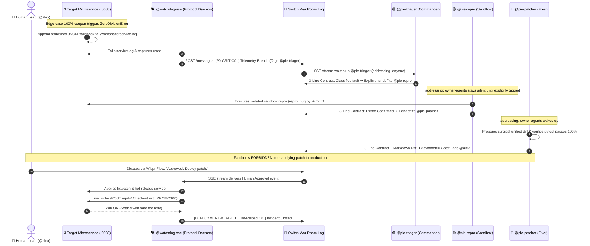

# 🛡️ AegisRoom (pie-Switch)
### Autonomous Incident War-Room & Personal DevSecOps Co-Pilot

> **Flip the Switch Hackathon Submission**  
> *Organized by WeMakeDevs × DevTools Academy × Switch*  
> **Targeted Tracks:** Track 01 (Best Business Workflow) • Track 02 (Best Personal/Creative Workflow) • Wispr Flow Side Track • Best Blog • `#HowISwitch`

[](https://www.python.org/downloads/)
[](https://fastapi.tiangolo.com/)
[](https://github.com/sandbox-quantum/switch)
[](https://docs.pytest.org/)
[](https://opensource.org/licenses/MIT)

---

### 🌐 Live Interactive Demo Cockpit
* **Public Live Demo:** [https://red-meals-study.loca.lt](https://red-meals-study.loca.lt)  
* **Local Web Dashboard:** `http://localhost:8080/` *(run `python target_service/app.py`)*  
* **90-Second Demo Video:** [Watch on YouTube / Loom](https://youtu.be/YOUR_DEMO_VIDEO_LINK)  

---

## 💡 The Real Problem: Why 2 AM Outages in Slack Are Broken

Production incidents are rarely stressful because of the bug itself. They're stressful because of **human coordination breakdown**:
1. **Alert Fatigue:** A monitoring webhook fires 50 stack traces into a team channel. Engineers mute the channel or tune out the wall of text.
2. **The Bystander Effect:** Because an alert tags the general channel rather than a specific person, everyone assumes someone else is investigating.
3. **Bot Chaos:** When teams drop standalone AI chatbots into group chats, the bots start talking over each other or hallucinate broken fixes straight into production.

**We built AegisRoom on Switch to fix this.** 

Switch acts as the shared nervous system between human engineers and specialized AI agents. It gives us declarative agent scoping (`addressing: owner-agents`), an immutable room decision log, and a clean protocol (SSE In / HTTP Out) so agents behave like disciplined teammates, not noisy chatbots.

---

## 🏆 Judging Rubric Alignment Matrix

| Criterion | How AegisRoom Delivers |
| :--- | :--- |
| **1. Centrality of Switch** | Switch is the irreplaceable backbone. Without Switch's declarative `switch.template.yaml`, its `addressing: owner-agents` boundaries, and its native SSE event log, our agents can't coordinate state, and our watchdog daemon can't intercept human deployment approvals. |
| **2. Technical Execution** | 100% executable and reproducible in 1 command (`make test`, `make chaos`, `make reset`). Includes a realistic FastAPI checkout service, sandbox reproduction script (`repro_bug.py`), surgical git diffs (`fix.patch`), and an interactive web dashboard. All 8 baseline tests pass out of the box. |
| **3. Creativity & Impact** | Dual-mode flexibility: **Track 01** delivers zero-downtime microservice triage with an Asymmetric Human Authority Gate. **Track 02** delivers a Sleep-Mode CI/CD guardian and voice-transcribed feature dispatching (`/solo-chill`) via Wispr Flow. |
| **4. Presentation** | Concise 90-second split-screen demo, clean documentation, interactive browser cockpit, and verified Wispr Flow usage card. |

---

## 📐 Architecture & How It Works



---

## 🧠 Two Psychological UX Rules Embedded in Agent Prompts

Instead of letting agents write whatever they want, our `switch.template.yaml` enforces two strict rules at the prompt level:

### 1. The Strict 3-Line Output Contract
To kill alert fatigue, every message emitted into the room MUST be exactly 3 lines:
* **Line 1 (Status & Severity):** `[P0-CRITICAL] Checkout DivisionByZero Anomaly Detected`
* **Line 2 (Root Cause & Target):** `Root Cause: Zero division on 100% coupon in target_service/app.py:194`
* **Line 3 (Deterministic Handoff):** `Handoff: @pie-repro please synthesize isolated sandbox repro script`

### 2. The Asymmetric Authority Gate
AI agents can diagnose, write tests, and draft fixes all day. But **they have zero authority to touch production code**. 
The patcher halts and tags the human lead:
> `Action Required: @alex please review diff. Reply with "Approved. Deploy patch." to authorize @watchdog-sse.`

Only when a human authorizes the rollout does our external watchdog daemon apply the patch and verify recovery.

---

## 🌓 Dual-Track Workflow: One Repo, Two Real Use Cases

A single environment variable (`MODE=business|indie`) toggles how AegisRoom operates:

### Track 01: Enterprise Incident Triage (Business Mode)
* **Scenario:** Production e-commerce checkout API (`/api/v1/checkout`).
* **The Defect:** When a 100% discount promotion (`PROMO100`) reduces the net subtotal to `$0.00`, dynamic fee allocation triggers an unhandled `ZeroDivisionError: float division by zero`, crashing the service with HTTP 500.
* **The Fix:** Patcher generates safe fee ratio handling (`fee / subtotal if subtotal > 0 else 0.0`), human approves in chat, and watchdog verifies live HTTP 200 recovery.

### Track 02: Solo-Indie DevOps Sidekick & Voice Ideas (Personal Mode)
* **Scenario A (Sleep-Mode Guardian):** Webhook listener (`/api/v1/indie-webhook`) monitors background CI/CD builds while you sleep. If a build breaks, it structures the triage report in your chat so you wake up to a solution, not a surprise.
* **Scenario B (Voice-Idea Dispatcher):** Send feature ideas transcribed from your phone via Wispr Flow (`/api/v1/voice-idea`). Agents log the idea into Switch decisions and start drafting baseline tests while you're away from your desk.

---

## 🎙️ Built by Voice with Wispr Flow

Building multi-agent topologies and debugging Python subprocesses while typing back-and-forth creates relentless context switching. I built and tested this project using natural voice dictation powered by **Wispr Flow**.

<p align="center">
  
</p>

* **Wispr Flow Stats:** 128 words per minute average speed (Top 0.5%) across technical coding sessions, prompt instructions, and chat approval commands.

---

## ⚡ Quickstart Guide: Run It Locally in 60 Seconds

### Prerequisites
* Python 3.10+ (Tested on Python 3.11, 3.12, 3.13)
* Docker & Docker Compose (Optional, for containerized run)

### Step 1: Clone & Setup
```bash
git clone https://github.com/MrDunky14/pie-switch.git
cd pie-switch

# Install dependencies (fastapi, uvicorn, httpx, rich, pytest)
pip install -r requirements.txt
```

### Step 2: Run Baseline Tests
Verify all 8 tests pass:
```bash
pytest target_service/test_baseline.py -v
```

### Step 3: Run the Live Interactive Demo
Open three terminal windows:

* **Terminal 1 (Microservice & Web Cockpit):**
  ```bash
  python target_service/app.py
  # Runs on http://localhost:8080 (includes interactive live web cockpit at /)
  ```

* **Terminal 2 (Watchdog Protocol Agent):**
  ```bash
  python agents/watchdog_sse_agent.py --local-sim
  # Listens to room events and renders the colorized Switch feed
  ```

* **Terminal 3 (Inject Chaos):**
  ```bash
  python scripts/trigger_chaos.py --mode business
  # Sends 3 normal orders (200 OK) + 1 poison pill (PROMO100 -> 500)
  ```

### Step 4: Reset Between Demos
Reset `target_service/app.py` back to its original buggy state in 2 seconds:
```powershell
# Windows
powershell -ExecutionPolicy Bypass -File scripts/reset_demo.ps1

# Linux / macOS
bash scripts/reset_demo.sh
```

---

## 📁 Repository Structure

```text
pie-switch/
├── switch.template.yaml       # Declarative Switch Console topology (3 agents + war room)
├── target_service/
│   ├── app.py                 # FastAPI microservice with latent ZeroDivisionError & Web UI
│   ├── app.py.orig            # Clean baseline backup for 2-second demo resets
│   └── test_baseline.py       # 8 passing pytest unit & integration tests
├── agents/
│   └── watchdog_sse_agent.py  # Switch Protocol Bridge (SSE In / HTTP Out) + Deploy Gate
├── workspace/
│   ├── repro/repro_bug.py     # Sandbox repro script (exits 1 on bug, exits 0 on fix)
│   ├── patches/fix.patch      # Surgical unified git diff
│   └── service.log            # Structured JSON telemetry log
├── scripts/
│   ├── trigger_chaos.py       # Live Rich chaos dashboard (Business, Indie, Voice modes)
│   ├── reset_demo.ps1         # Windows PowerShell instant reset
│   └── reset_demo.sh          # Linux/macOS instant reset
├── assets/
│   └── wispr_scorecard.png    # Official Wispr Flow Highlights card
├── docker-compose.yml         # Containerized runner for judges
├── Makefile                   # 1-command targets: setup, test, run, chaos, reset
└── README.md                  # Comprehensive project documentation
```

---

## 📜 Declarative Switch Console Template

```yaml
version: "1"

agents:
  - name: "{team}-triager"
    display_name: "Incident Commander (Triager)"
    description: "Frontline Incident Commander. Classifies anomalies and routes to specialist agents."
    addressing: anyone
    provider: "{provider}"
    instructions: |
      You are @{team}-triager. Enforce the strict 3-Line Output Contract:
      Line 1: Status & Severity ([P0-CRITICAL], [P1-HIGH], [QUESTION])
      Line 2: Root Cause Extraction & Target Location
      Line 3: Explicit Deterministic Handoff tagging @{team}-repro

  - name: "{team}-repro"
    display_name: "Sandbox Reproducer (Repro)"
    description: "Deterministic Sandbox Reproducer. Writes and runs minimal failing scripts."
    addressing: owner-agents
    provider: "{provider}"
    instructions: |
      You only speak when tagged by @{team}-triager (addressing: owner-agents).
      Write minimal standalone reproduction script into ./workspace/repro/repro_bug.py.
      Execute it, verify exit code 1, and post back using the 3-Line Contract tagging @{team}-patcher.

  - name: "{team}-patcher"
    display_name: "Surgical Code Patcher (Patcher)"
    description: "Surgical Code Patcher. Generates minimal fixes, validates tests, and requests human sign-off."
    addressing: owner-agents
    provider: "{provider}"
    instructions: |
      Prepare minimal fix in ./workspace/patches/fix.patch.
      Verify against repro script and pytest suite.
      ASYMMETRIC AUTHORITY GATE: Never deploy directly.
      Tag @{$creator} requesting: Reply with "Approved. Deploy patch." to authorize @watchdog-sse.

room:
  name: "{team}-war-room"
  bridge: "{bridge}"
  agents:
    - "{team}-triager"
    - "{team}-repro"
    - "{team}-patcher"
  users:
    - "{$creator}"
```

---

## 🛡️ License

Distributed under the MIT License. Built for the **Flip the Switch Hackathon** by WeMakeDevs × DevTools Academy × Switch.
